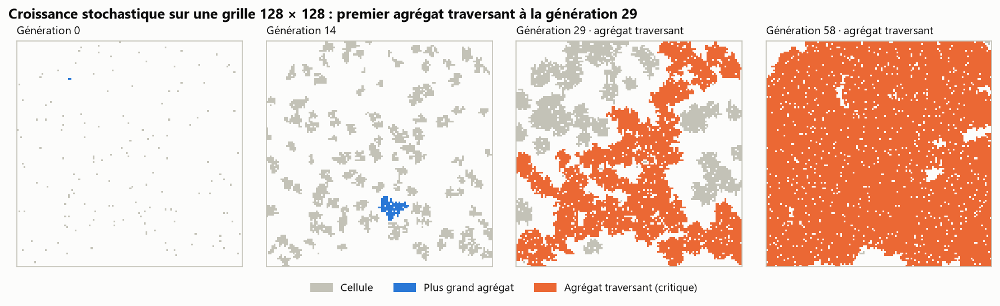
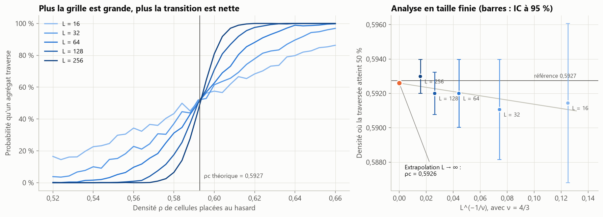
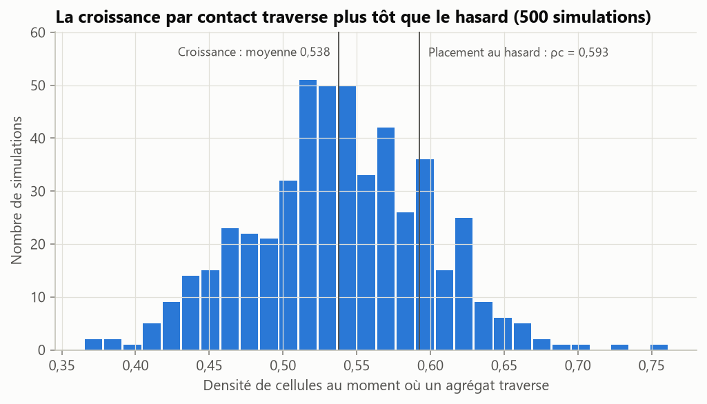
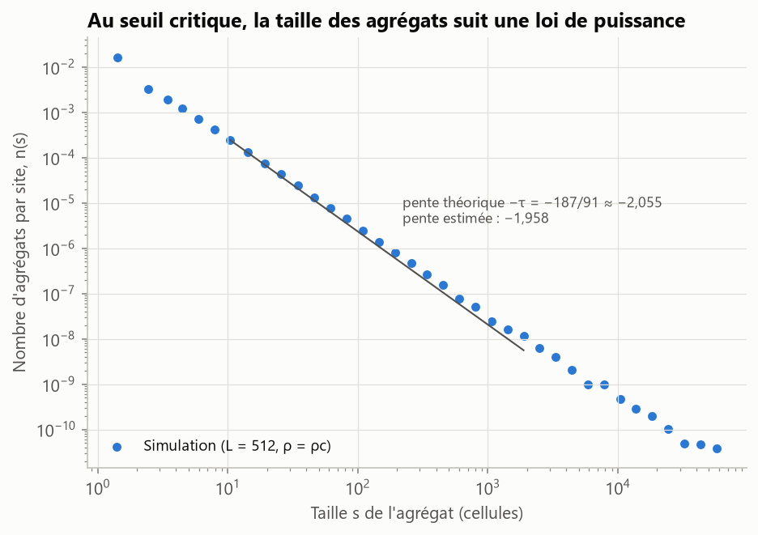
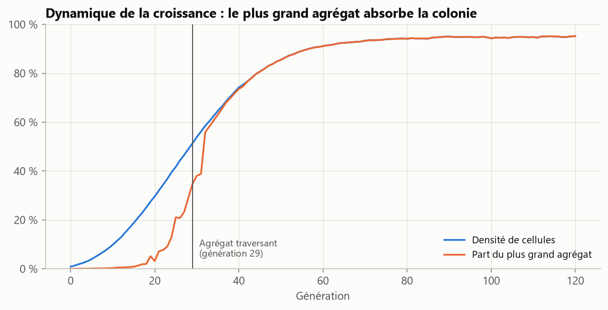

# Croissance cellulaire stochastique et agrégats critiques

[](https://github.com/narusly/automate-cellulaire/actions/workflows/tests.yml)

Un automate cellulaire stochastique fait croître une colonie de cellules. On repère l'instant où un agrégat
devient « critique », c'est-à-dire qu'il traverse tout le tissu, et on le compare à la théorie de la
percolation, dont on retrouve le seuil par simulation de Monte Carlo.

## En bref

- **Seuil de percolation retrouvé.** Avec des cellules placées au hasard, l'analyse en taille finie donne
  ρc = 0,5926, pour une valeur de référence de 0,5927. Chaque taille de grille est compatible avec la
  référence compte tenu de son intervalle de confiance ; l'incertitude sur ρc est d'environ ±0,001.
- **La croissance devient critique plus tôt que le hasard.** Dans l'automate, le premier agrégat
  traversant apparaît à une densité de 0,538 ± 0,005 (500 simulations), contre 0,593 pour un placement
  aléatoire : la division de proche en proche crée des amas connexes.
- **Loi de puissance au point critique.** La taille des agrégats suit n(s) ∝ s^−τ. L'estimation τ = 1,96
  approche la valeur exacte 187/91 ≈ 2,055 ; l'écart de 5 % vient des corrections de taille finie (voir
  les limites).



## Modèle

**Automate de croissance** sur une grille 128 × 128, mise à jour simultanée à chaque génération :
- une case vide est colonisée avec probabilité 1 − (1 − p)^k, où k est le nombre de voisines occupées
  (voisinage de 4) : chaque voisine tente indépendamment de se diviser vers elle, avec p = 0,12 ;
- une cellule meurt avec probabilité q = 0,02 ;
- ensemencement initial au hasard, densité 1 %.

**Agrégat** : ensemble de cellules reliées par un côté (4-connexité), étiqueté avec `scipy.ndimage`.
**Agrégat critique** : agrégat qui relie le bord haut au bord bas de la grille.

**Percolation de sites** : chaque case est occupée indépendamment avec probabilité ρ. On estime par Monte
Carlo (1 000 grilles par point) la probabilité qu'un agrégat traverse, pour L = 16 à 256, puis la densité
ρ½(L) où elle vaut 50 %. La théorie prévoit ρ½(L) = ρc + a·L^(−1/ν) avec ν = 4/3 exactement en dimension
2 : une régression linéaire en L^(−3/4) donne ρc à l'ordonnée à l'origine.

## Résultats



| L | ρ½(L) | IC 95 % |
|---:|---:|---:|
| 16 | 0,5914 | ± 0,0046 |
| 32 | 0,5911 | ± 0,0029 |
| 64 | 0,5920 | ± 0,0020 |
| 128 | 0,5920 | ± 0,0012 |
| 256 | 0,5930 | ± 0,0010 |

Les intervalles viennent de la méthode delta : erreur standard de la proportion simulée, divisée par la
pente de la courbe, estimée par régression autour du croisement.

<table>
<tr>
<td></td>
<td></td>
</tr>
</table>



Le premier agrégat traversant apparaît en moyenne à la génération 28,9 (écart-type 2,8). Il absorbe
ensuite la quasi-totalité de la colonie.

## Limites et pistes

- La pente τ est estimée sur s de 10 à 2 000. Aux petites tailles, les corrections au comportement
  asymptotique faussent la loi de puissance ; aux grandes, la taille finie de la grille coupe la
  distribution. Des grilles plus grandes et un ajustement avec terme correctif réduiraient l'écart.
- La pente de l'analyse en taille finie est faible devant le bruit Monte Carlo : l'excellent accord sur ρc
  est en partie favorable, l'incertitude réelle est d'environ ±0,001.
- Le modèle de croissance ignore les nutriments et la géométrie réelle d'un tissu ; il illustre un
  mécanisme, il ne décrit pas une biologie précise.

## Reproduire

```bash
python -m venv .venv
source .venv/bin/activate            # Windows : .venv\Scripts\activate
pip install -e ".[dev]"
pytest                               # 9 tests
python -m automate.report            # régénère reports/ (environ 1 minute)
```

## Structure

```
src/automate/clusters.py      étiquetage des agrégats, agrégat traversant
src/automate/growth.py        automate de croissance stochastique
src/automate/percolation.py   probabilité de traversée, point de croisement, taille finie, exposant τ
src/automate/report.py        analyse complète, tableaux et figures
tests/                        connexité, cas limites, reproductibilité, extrapolation
```

---
Maxime Fruntes · Master 2 Mathématiques appliquées (Probabilités et Statistiques), Université de Lorraine ·
[LinkedIn](https://www.linkedin.com/in/maxime-fruntes-2538543a5/) · Licence MIT
